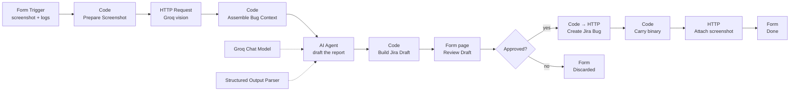

# Screenshot → Jira Bug Reporter (n8n AI Agent)

**Workflow file:** `01_Screenshot_to_bug_reporter_AIagent.json`

Bug reporting is tedious and inconsistent. A tester sees something break, screenshots it, then
spends ten minutes turning that image into prose — and still forgets the browser version, still
writes "it doesn't work" under Actual Result. This workflow collapses that into: upload the
screenshot, read the draft, click file.

| | |
|---|---|
| **Input** | UI screenshot + error logs, via an n8n Form |
| **Output** | A Jira Bug in project `KAN` with steps to reproduce and the screenshot attached |
| **Human in the loop** | Yes — the draft is shown for review before anything is written to Jira |
| **Models** | Groq: Llama 4 Scout (vision) → Llama 3.3 70B (drafting) |

---

## 1. A naming trap worth clearing up first

**Groq** and **Grok** are different companies and are not interchangeable:

| | Groq | Grok |
|---|---|---|
| Who | groq.com — an inference provider | x.ai (Elon Musk's xAI) |
| Models | Llama, Qwen, Kimi, GPT-OSS | Grok 3, Grok 4 |
| Key name | `GROQ_API_KEY` | `XAI_API_KEY` |
| API base | `api.groq.com/openai/v1` | `api.x.ai/v1` |
| Free tier | Yes, generous | No |
| grok.com | — | The **chat UI**. It has **no API**, so n8n cannot use it. |

You have a `GROQ_API_KEY`, so this workflow is built on **Groq**. It runs on Groq's free tier.
[§8](#8-swapping-the-model-provider) shows how to switch to xAI Grok, OpenAI or Anthropic —
it's a two-node change.

---

## 2. How it flows



### Why it's split this way

**Two model calls, not one.** The vision model is asked to *describe*, never to *diagnose*.
Its prompt demands verbatim text transcription, UI state, and — importantly — a
`NOT VISIBLE` section listing what the screenshot fails to show. The drafting agent then
reasons over that description as text. Merging both jobs into one call reliably produces
confident, invented reproduction steps; splitting them gives the second model a factual
substrate it can't silently expand on.

**The agent never sees the image.** That is deliberate, not a limitation. It keeps the
drafting model swappable — any chat model node works, vision-capable or not.

**A Structured Output Parser, not free text.** Severity and priority are enums, steps are an
array, and there is an `openQuestions` field. That last one matters: it gives the model a
sanctioned place to admit a gap instead of papering over it with a plausible step.

**Plain HTTP Request nodes for Jira, not the Jira node.** The Jira node's Project and Issue
Type fields want *numeric IDs* fetched from your instance, which makes an exported workflow
unportable. REST API v2 accepts `{"project":{"key":"KAN"},"issuetype":{"name":"Bug"}}`
directly, so this file works against any Jira site after one URL edit.

---

## 3. Prerequisites

- **n8n 1.70+** (self-hosted or Cloud). The AI Agent node at typeVersion 2 and Form nodes at
  typeVersion 2.2 need a recent build.
- A **Groq API key** — free at <https://console.groq.com/keys>.
- A **Jira Cloud API token** — <https://id.atlassian.com/manage-profile/security/api-tokens>.
- The Jira site: `https://myfirstaiproject.atlassian.net`, project key `KAN`.

### Check `Bug` exists in KAN first

`KAN` is a default Kanban project, and team-managed Kanban boards often ship with only
**Task**, **Epic** and **Subtask**. If `Bug` isn't enabled, the create call fails with
`"issuetype: valid issue type is required"`.

Fix it in **Project settings → Issue types → Add issue type → Bug**. If you'd rather not
change the project, edit the `Finalize Jira Payload` node and change `name: 'Bug'` to
`name: 'Task'`.

---

## 4. Credentials to create in n8n

Two, both under **Credentials → Add credential**.

**1. Groq API** (type: *Groq*)
- API Key: your `GROQ_API_KEY`
- Used by: `Vision - Read the Screenshot` (as a predefined credential type) and `Groq Chat Model`

**2. Jira Basic Auth** (type: *Basic Auth*)
- User: your Atlassian account email
- Password: your Jira **API token**, not your Atlassian password
- Used by: `Create Jira Bug` and `Attach Screenshot to Jira`

> Basic Auth is used rather than n8n's Jira credential because the HTTP Request node's
> predefined-credential list doesn't reliably expose Jira across versions. If your n8n
> does offer it, switching Authentication to *Predefined Credential Type → Jira SW Cloud*
> works identically.

---

## 5. Setup, end to end

1. **Import** — n8n → *Workflows* → *Import from File* → `01_Screenshot_to_bug_reporter_AIagent.json`.
2. **Attach credentials** — open the four nodes with a red credential warning
   (`Vision - Read the Screenshot`, `Groq Chat Model`, `Create Jira Bug`,
   `Attach Screenshot to Jira`) and pick the credentials from §4.
3. **Point at your Jira** — if you're not using `myfirstaiproject.atlassian.net`, search-and-replace
   that hostname in `Create Jira Bug` and `Attach Screenshot to Jira`, and change the
   `project.key` in `Finalize Jira Payload`.
4. **Test** — click *Execute workflow*, open the test form URL, upload a screenshot of a real
   defect, paste any console output, submit.
5. **Review** — the draft appears on a second page. Override the summary or add notes if you
   want, choose *Yes — create the ticket*, submit.
6. **Verify** — the final page links straight to the new issue. Check the screenshot is on the
   ticket under *Attachments*.
7. **Activate** — toggle *Active* to get the permanent production form URL. Share that URL with
   testers; they need no n8n account.

---

## 6. Node reference

| Node | Type | What it does |
|---|---|---|
| `Bug Intake Form` | Form Trigger | Six fields: screenshot (required), what you were doing, error logs, environment, severity gut feel, reporter. |
| `Prepare Screenshot` | Code | Finds the binary property **by lookup rather than by hardcoded name** (n8n's naming for form file uploads has changed between versions), rejects non-images, guards the ~4 MB Groq payload ceiling, base64-encodes to a data URL, and builds the vision request body. |
| `Vision - Read the Screenshot` | HTTP Request | `POST api.groq.com/openai/v1/chat/completions` with `meta-llama/llama-4-scout-17b-16e-instruct`. Retries 3× — free-tier rate limits are the most common transient failure. |
| `Assemble Bug Context` | Code | Merges the vision write-up with the tester's typed input into one prompt. |
| `Bug Report Agent` | AI Agent | Drafts the report under a QA system prompt (summary format, atomic steps, `(inferred)` marking, severity rubric). |
| `Groq Chat Model` | Groq Chat Model | `llama-3.3-70b-versatile`, temperature 0.2. |
| `Bug Report Schema` | Structured Output Parser | 15-field JSON schema, 11 required. |
| `Build Jira Draft` | Code | Renders Jira wiki markup **and** the HTML preview. Strips stray leading numbers from steps, sanitises labels to kebab-case (Jira rejects labels with spaces), truncates the summary to 250 chars. |
| `Review Draft` | Form (page) | Shows the draft, waits for a human. |
| `Approved` | If | Branches on the dropdown. |
| `Finalize Jira Payload` | Code | Applies the summary override and prepends reviewer notes as a Jira `{panel}`. |
| `Create Jira Bug` | HTTP Request | `POST /rest/api/2/issue`. |
| `Carry Screenshot Binary` | Code | Jira's create response carries no binary, so this pulls the original file back off the trigger item. |
| `Attach Screenshot to Jira` | HTTP Request | `multipart/form-data` with `X-Atlassian-Token: no-check`. Set to **continue on error** — a failed upload must not mask a ticket that was created fine. |
| `Done` / `Discarded` | Form (completion) | Final pages. |

### Example output

Given a checkout screenshot showing a 500 banner plus a pasted console trace, the ticket body is:

```
h2. Steps to Reproduce
*Preconditions*
* A customer account exists with at least one item in the basket

# Log in as a standard customer and add SKU-4471 to the basket
# Open the basket and click Proceed to checkout
# Enter promo code SAVE20 in the Discount code field
# Click Apply

h2. Expected Result
The 20% discount is applied and the order total drops from GBP 84.00 to GBP 67.20.

h2. Actual Result
A red banner reads "Something went wrong (500)" and the total stays at GBP 84.00.

h2. Visual Observations (from the attached screenshot)
* Red error banner at the top of the order summary card reading "Something went wrong (500)"
* Discount code field retains the value SAVE20 and is outlined in red
* The Place order button is greyed out (inferred: disabled while the error is present)
...
```

Labels come out as `checkout`, `promo-codes`, `500-error`, `ai-drafted`, `severity-critical`.

---

## 7. Troubleshooting

| Symptom | Cause | Fix |
|---|---|---|
| `valid issue type is required` | `Bug` not enabled in KAN | See §3, or switch to `Task` |
| `401 Unauthorized` from Jira | Atlassian password used instead of an API token | Regenerate an API token |
| `Field 'priority' cannot be set` | Team-managed projects often hide Priority | Already avoided — severity lives in the description and labels instead |
| `413` or `Request too large` | Screenshot over ~4 MB | The Prepare node catches this first with a readable message; crop or compress |
| `rate_limit_exceeded` | Groq free tier | The vision node already retries 3×; lower the drafting model if it persists |
| Agent output fails to parse | Model drifted from the schema | Lower temperature, or attach an **Auto-fixing Output Parser** in front of the structured one |
| Ticket created but no attachment | Attach node failed | It's set to continue on error by design — check that node's output for the Jira response |
| `No screenshot was received` | Form field left empty, or a version quirk in binary naming | The Prepare node reports which binary keys it actually saw |

---

## 8. Swapping the model provider

Only two nodes know about Groq.

**To xAI Grok** (if you get a key from console.x.ai):
- `Vision - Read the Screenshot`: URL → `https://api.x.ai/v1/chat/completions`, credential type → `xAiApi`.
  In `Prepare Screenshot`, change `model` in `visionBody` to `grok-4`.
- Replace `Groq Chat Model` with the **xAI Grok Chat Model** node and reconnect it to the agent's
  *Chat Model* input.

**To OpenAI:** URL → `https://api.openai.com/v1/chat/completions`, model → `gpt-4o`, credential
type → `openAiApi`; swap in the OpenAI Chat Model node.

**To Anthropic:** the vision call needs Anthropic's own message shape rather than the
OpenAI-compatible one, so rewrite `visionBody` in `Prepare Screenshot` to use
`source: { type: 'base64', media_type, data }`; swap in the Anthropic Chat Model node.

---

## 9. Known limits

- **The summary override is a placeholder, not a prefill.** n8n's Form node has no default-value
  parameter, so the drafted summary is shown as grey placeholder text. Leave the field blank to
  keep the AI's version.
- **One screenshot per report.** `multipleFiles` is off. Supporting several means looping the
  vision call and concatenating the analyses.
- **No duplicate detection.** The same bug filed twice creates two tickets.
- **The vision model can misread low-contrast or downscaled text.** That's what the review step
  is for — and why the prompt asks it to flag anything unreadable rather than guess.

## 10. Where to take it next

- **Search before filing** — add a Jira search call on the summary keywords and route likely
  duplicates to a comment on the existing ticket instead of a new one.
- **Slack intake** — swap the Form Trigger for a Slack trigger so testers file bugs by dropping
  a screenshot into a channel.
- **Auto-assign** — map `affectedArea` to a component and its default assignee.
- **Close the loop** — post the ticket link back to the reporter, and attach the n8n execution ID
  to the ticket for traceability.
